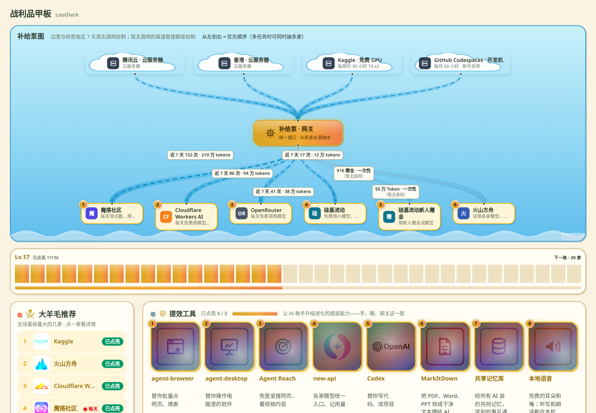
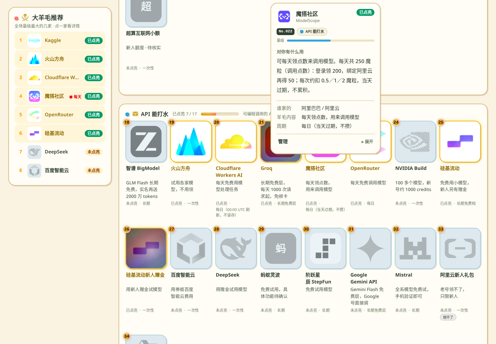
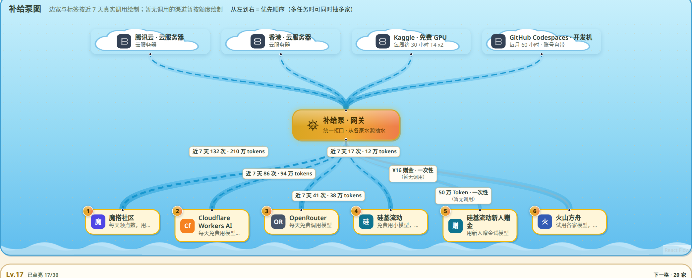

# LootDeck · 战利品甲板 —— 一个 Muse 空间应用，专管你的 AI 资源

**LootDeck（战利品甲板）是一个运行在 Muse 空间（Space）里的 AI 资源管理器**：把散落全网的免费额度——模型 API、免费 VPS / GPU 算力、提效工具——登记成一本可视化图鉴，管领取、管过期、管调度。它同时是 [QShip](https://github.com/QS-qusheng/QShip) 的「战利品甲板」：QShip 是一套「船长只动嘴、AI 船员干活」的多智能体协作系统，LootDeck 是其中负责全舰 AI 资源的那块甲板——Loot（战利品）是船员从全网带回的收获，Deck（甲板）是它们在船上的存放与调度之处。本仓库是 LootDeck 的完整源码，可独立在你自己的 Muse 里复刻使用，不依赖 QShip 本体。

**LootDeck is an AI resource manager that runs as a Muse Space app.** It turns every free AI resource scattered across the internet — free model API quotas, free VPS/GPU compute, and productivity tools — into one visual, collectible catalog: what has been claimed, what is about to expire, and how the gateway routes calls so nothing goes to waste. It is also the "loot deck" of QShip, a multi-agent collaboration system. This repository contains the full source; you can recreate it inside your own Muse and use it standalone.



---

## 它解决什么问题

免费额度到处都是，但没人管得住：

- **散**：魔搭、硅基流动、OpenRouter、Groq、Kaggle、Codespaces……几十个平台各有一份免费额度，散落在几十个账号里，想不起来自己到底领过什么。
- **过期没人管**：很多额度是每日刷新、限时赠金、试用期到期，不用就作废，过期了才想起来等于白领。
- **领没领全靠记性**：没有台账，就会重复注册、漏领，或者对着一个早已抽干的水源空等。

LootDeck 把这三件事收进一页：**领了的点亮成图鉴，没领的一眼可见；快过期的亮红点催你先烧；所有 API 调用经一个网关出水，按「快过期先烧」自动调度。**

## 常见问题

### 有哪些免费的 AI 额度可以领？

按资源类型分四类（本项目内置目录，数字来自各平台公开的免费层政策，会随官方调整变化，以官方为准）：

- **模型 API 免费层**：魔搭社区（每日免费推理额度）、硅基流动（新人赠金 + 免费小模型）、Cloudflare Workers AI（每日免费 Neurons）、OpenRouter（免费模型）、火山方舟、Groq、Google Gemini API、智谱 BigModel、Mistral、NVIDIA Build 等。
- **免费算力 / VPS**：Kaggle（每周免费 GPU 时长）、GitHub Codespaces（每月免费时长）、Google Cloud / Azure / AWS 试用赠金、甲骨文永久免费层等。
- **提效工具**：给 AI 装备的底层能力件，如浏览器自动化、文档转 Markdown、共享记忆、本地语音等。
- **工具福利**：各类 AI 工具的免费试用与赠送额度。

目录里每一家都写明了「对你有什么用、额度多少、什么周期刷新、领没领」，点开是详情价值卡：



### 多家 API 额度怎么统一管理？

两个层面：

1. **台账层面**：一张图鉴管全部。每家一张卡，点亮 = 已经领好；未点亮 = 还没领。战令等级按点亮数推进，收集进度一眼可见。
2. **调用层面（可选）**：所有 API 调用收口到一个自托管网关（new-api，见「如何使用」的可选部分），各家渠道按优先级排队，一家限速或抽干自动切下一家；调用统计按渠道回流到补给泵图，近 7 天真实调用量直接画在管子上。不接网关也完全不影响台账与图鉴功能。

### 额度快过期了，怎么不浪费？

- **到期红点**：每家卡有自己的刷新/到期周期（每天、每周、一次性赠金……），本周期还没处理完的卡亮红点提醒。
- **快过期先烧**：网关调度补了一条规则——同一优先级内，优先调用额度最快到期的渠道，先把要过期的烧掉，再用长期额度。
- **每日自动刷新**：可设定时任务每日刷新各家的过期时间锚点，并把网关近 7 天的真实调用统计同步回图鉴页面。

## 功能一览

- **四分区图鉴目录**：提效工具 / 免费 VPS / API 能打水 / 工具福利，每家一张卡：官方 Logo、圆形图鉴角标、「对你有什么用」的价值句、额度与状态小字。
- **点亮与战令**：领好一家点亮一家，战令等级 = 已点亮数量，图鉴完成度像游戏进度条一样推进。
- **到期提醒**：按各家周期（每日 / 每周 / 每月 / 一次性）追踪处理状态，未处理亮红点。
- **补给泵图**：一张水系图画清资源流向——云端服务器在上、补给泵（网关）在中、水源（各家渠道）在下；水柱粗细按额度或近 7 天真实调用量分档，一眼看出哪家在供水、哪家快干了。



- **示例状态**：新实例先以内置示例数据起步、顶部横幅明确标注；你点亮/修改/新增任意一家即自动翻转成你自己的看板，示例数据清场、永不混入。
- **清新甲板界面**：LootDeck 就是这个样子——科技风打底、收集图鉴感、清新色系、2.5D 厚圆角卡片；界面即主题，不另设素版。

## 数据口径

- 本仓库内置目录中的额度数字，来自各平台**公开的免费层政策与官方页面**，为项目维护时点的记录；各平台政策随时可能调整，**请以官方最新说明为准**。
- 仓库内的台账数据是**演示数据**（见 `data.example/`），不包含任何真实账号的领取记录；目录结构（39 家的分类与条目）保留作示例，你可以按自己的账号情况增删。
- 本项目不对任何平台的可用性、额度真实性作保证。

## 如何使用

### 它是个什么结构

LootDeck 是一个 **Muse Space 全栈应用**，源码分三层：

| 层 | 位置 | 说明 |
|---|---|---|
| 前端 | `client/` | React + Tailwind 页面（图鉴、战令、补给泵图、主题样式都在这一层） |
| 服务端动作 | `server/src/actions.ts` | 台账的读写动作与内置目录 `CATALOG`，由 Muse 的 Space 运行时托管执行 |
| 数据结构 | `server/src/schema.ts` + `drizzle/` | 数据库表定义与迁移 SQL；运行时数据存应用自己的 SQLite 数据库 |

**GitHub 源码与 Space 的关系**：这个仓库是源码的事实源；Space 是它在 Muse 里跑起来的实例。原作者的 Space 里跑的是作者自己的台账（数据不在本仓库）；你 clone 本仓库、在自己的 Muse 里把它建成一个 Space，得到的就是**你自己的** LootDeck 实例，台账从演示目录初始化，之后记的全是你的数据。

### 在你自己的 Muse 里复刻（推荐用法）

环境要求：一个可使用 Spaces 的 Muse 账号；本地改代码时需要 [Bun](https://bun.sh)（或 Node.js）拉取依赖、做类型检查与构建校验。

1. Clone 本仓库到你的 Muse 工作区：
   ```bash
   git clone https://github.com/QS-qusheng/LootDeck.git
   ```
2. 在 Muse 里把该目录作为一个 TypeScript Space 打开/创建（入口与运行时声明在 `space.json`：入口 `client/dist/index.html`、运行时 `typescript`）。Space 运行时会提供 `@hatch/space-sdk` 与数据库，`package.json` 里该依赖指向你本机 Muse 的 spaces 运行时路径，如路径不一致，按你本机运行时位置调整这一行即可。
3. 首次打开页面时，应用会先写入 5 家种子条目、再自动执行一次目录同步（`syncCatalog`），把内置 39 家目录补齐成图鉴。新实例从**示例状态**起步：整张甲板是内置示例数据、顶部横幅明确标注「示例状态」，其中有两张示例专属的服务器卡（示例状态逻辑见 `data.example/README.md`）。
4. 不用手动切换：在示例状态下点亮任意一家、修改任意一家、或新增一家，都算添置了你的第一件战利品——应用会自动翻转到**你自己的状态**（你动手的那行保留，其余示例数据复位、示例专属卡清场消失），之后记的全是你的数据，再不混入示例。

### 把演示数据换成你自己的

- **领取状态、key 尾号、备注、上次处理时间是个人记录**：演示目录里它们是示例值（状态全为未领、尾号与备注为空）；补给泵图上方的服务器层只在示例状态（或看板里还有示例专属条目时）出现，翻转到你自己的状态后自动隐藏。逐项说明与模板在 [`data.example/README.md`](data.example/README.md)，照着改：
  - 在页面上点开每张卡，即可更新状态与备注（日常用法，不用碰文件）；
  - 想批量规划目录，先改 `data.example/providers.example.json` 做草稿，再对应改 `server/src/actions.ts` 的 `CATALOG`（增删平台、改文案都在这里），重新部署后打开页面会自动同步进你的台账，且**不会覆盖**你已记的状态、备注与 key 尾号。
- **补给泵图上方的服务器节点**是示例配置（`client/src/components/pump-diagram.tsx` 里的 `SERVERS`），改成你自己的服务器名即可。
- **真实数据库文件（`app.db`）不要提交到任何公开仓库**——`.gitignore` 已排除；完整 key 更不要写进任何文件，台账里只记尾号。

### 本地构建校验（可选，开发者）

```bash
bun install        # 安装依赖（@hatch/space-sdk 为本地运行时包，见上）
bun run build      # 构建服务端动作与前端 bundle，验证工程完整
bun run typecheck  # 类型检查
```

注意：脱离 Muse 的 Space 运行时，页面可以构建，但服务端动作与数据库由宿主提供，无法独立起一个完整后端——完整运行请走上面的 Space 复刻方式。

### 网关部分（可选）

统一 API 调度是可选项，不接不影响图鉴与台账：

1. 自行部署开源网关 [new-api](https://github.com/QuantumNous/new-api)（AGPLv3），把各家渠道的 key 填进网关（key 只存网关，不进本项目）。
2. 给每个渠道填「额度过期时间」：本项目的「快过期先烧」是在网关渠道选择上加的一条最小规则——同优先级内先选过期最早的一组渠道，补丁思路见「二次开发」。
3. 把网关近 7 天的分渠道调用量聚合后，调用本项目的服务端动作 `syncGatewayStats` 写回，补给泵图就会按真实调用绘制；不写回时泵图按额度绘制。

## 二次开发

- **目录数据**：平台目录是结构化数据（名称、分区、价值句、额度文案、周期、Logo 路径等），增删一家只是改 `server/src/actions.ts` 的 `CATALOG`，不用动界面代码。
- **界面与主题**：呈现层在 `client/src/App.tsx` 与 `client/src/theme.css`（样式与主题是一层，`data-deck="on"` 恒开）；换风格改样式层即可，数据与动作不受影响。
- **网关调度**：「快过期先烧」规则本身在网关侧实现（渠道带额度过期时间，同优先级内先选最早过期的一组，其余仍按原权重），可迁移到其他基于优先级 + 权重的网关。

## 免责声明

本项目是个人资源管理工具，与目录中提及的任何平台均无隶属或合作关系。各平台免费政策由其官方决定，可能随时变更或终止；请遵守各平台的服务条款，合理使用免费额度。因使用本项目产生的任何账号、额度或合规问题，由使用者自行承担。

## 开源素材致谢

- 界面图标部分取自 [game-icons.net](https://game-icons.net)（CC BY 3.0），字体使用 Google Fonts 的开源字体（OFL），像素木纹理取自 OpenGameArt 的 CC0 素材，战令轨道组件来自 bigbullui（MIT）。具体出处见页面页脚署名行。
- 补给泵图基于 React Flow（@xyflow/react，MIT）渲染；网关部分基于 [new-api](https://github.com/QuantumNous/new-api)（AGPLv3），其许可证义务独立适用于网关组件，请一并遵守。

## License

[MIT](LICENSE) © QS-qusheng（网关组件除外，见上）。

---

### English summary

**LootDeck （战利品甲板） is an AI resource manager that runs as a Muse Space app** — a visual catalog for every free AI resource you have collected: free model API quotas, free VPS/GPU compute, and AI productivity tools, across four sections with a claim-and-light-up collection mechanic, per-provider refresh cycles with expiry reminders, and a supply-pump diagram that shows how an optional self-hosted gateway routes API calls — burning the soonest-to-expire quota first. To use it, clone this repo into your own Muse workspace and open it as a TypeScript Space; the ledger initializes from the demo catalog in `data.example/`, which you then replace with your own claim records. Quota figures come from each provider's published free-tier policy and may change; always check the official source. Demo data only; no real account records are included. MIT licensed (gateway component under AGPLv3, see above).
